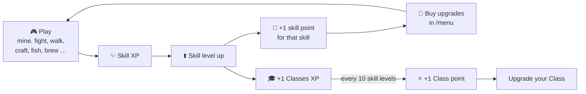

---
{"dg-publish":true,"permalink":"/leveling-plugin/","title":"Leveling Plugin","tags":["plugin","minecraft","guide","leveling","rpg","skills","home","gardenEntry"],"dg-note-properties":{"title":"Leveling Plugin","tags":["plugin","minecraft","guide","leveling","rpg","skills","home","gardenEntry"],"aliases":["Home","Leveling","Overview"]}}
---

# Leveling Plugin

> [!TIP] New here?
> Read the [[Beginner Guide\|Beginner Guide]] first. It explains your first hour in about five minutes.

## 1. Overview

**Leveling** turns survival Minecraft into a skill-based RPG. You start out weaker than in vanilla. You have half the hearts, you walk slower, you can't wear armor and almost your whole inventory is locked. Everything you do (fighting, mining, walking, crafting, fishing, farming, brewing, enchanting, healing) gives XP in a matching **skill**. Every skill level gives you **1 skill point** for that skill. You spend points in the `/menu` to buy back your strength, and later to go far past vanilla limits.

How it changes the game:

- **Progression matters again.** Armor, the Elytra, inventory space and even your walking speed have to be earned. See [[Starting Stats\|Starting Stats]].
- **You build your own character.** Ten skill trees and four combat [[Skills/Classes\|Classes]] let you build a tank, an archer, a bare-fisted brawler or a speedy explorer. Your **first class is free** and you can pick it the moment you join.
- **PvP has stakes.** Killing a player steals their Combat XP, and the Combat Level under every name tag lets you judge a fight. See [[PvP and Death Penalty\|PvP and Death Penalty]].
- **Brewing goes beyond vanilla.** Brew Speed III+, Strength IV, Regeneration V and longer potions. See [[Custom Potion Brewing\|Custom Potion Brewing]].
- **Resetting is free.** Every tree can be refunded at any time, so experimenting is safe.

## 2. Obsidian Tags

`#plugin` `#minecraft` `#guide` `#leveling` `#rpg` `#skills` `#pvp` `#brewing` `#classes` `#upgrades`

## 3. Commands

| Command | Who | Description & Syntax | Example |
|---|---|---|---|
| `/menu` | Everyone | Opens your Leveling menu with all skills, levels and XP. **Left-click** a skill to open its upgrade tree, then click an upgrade to buy it. | `/menu` |

That's the only command you need. Everything else happens by playing.

## 4. Gameplay Mechanics & Features

### The core loop

1. **Do things** → earn XP in the matching skill. See [[Skills and Skill Points\|Skills and Skill Points]].
2. **Level up** → chat shows `Mining Level 3 Reached` and you get **+1 point** for that skill.
3. **Each skill level also gives 1 Classes XP**, so every 10 skill levels give **1 Class point**. See [[Skills/Classes\|Classes]].
4. **Open `/menu`** → click a skill → click an upgrade.
5. **Change your mind?** The iron door in every tree refunds all its points.

All trees on one page: **[[Upgrade Trees\|Upgrade Trees]]**

### Skill trees

| Skill | Menu icon | What you unlock | Note |
|---|---|---|---|
| Classes | Player head | Tank, Melee, Bare-Handed, Ranged | [[Skills/Classes\|Classes]] |
| Combat | Iron sword | Damage, attack speed, knockback, bow & fist damage | [[Skills/Combat Skill\|Combat Skill]] |
| Mining | Iron pickaxe | Mining speed, ore luck, **armor tiers** | [[Skills/Mining Skill\|Mining Skill]] |
| Defense | Shield | Max HP, armor, toughness, regeneration | [[Skills/Defense Skill\|Defense Skill]] |
| Inventory | Chest | **Inventory slots** | [[Skills/Inventory Skill\|Inventory Skill]] |
| Movement | Leather boots | Walking speed, **Elytra** | [[Skills/Movement Skill\|Movement Skill]] |
| Enchanting | Enchanting table | Revive, dodge, more vanilla XP | [[Skills/Enchanting Skill\|Enchanting Skill]] |
| Brewing | Potion | Fire safety, stronger & longer potions | [[Skills/Brewing Skill\|Brewing Skill]] |
| Farmer | Diamond hoe | Crop luck, buffed wolf pets | [[Skills/Farming Skill\|Farming Skill]] |
| Fishing | Fishing rod | Fishing luck, oxygen, underwater mining | [[Skills/Fishing Skill\|Fishing Skill]] |

### Special systems

- [[Starting Stats\|Starting Stats]]: what's weaker than vanilla and how you win it back
- [[PvP and Death Penalty\|PvP and Death Penalty]]: XP stealing, the frozen state after losing levels, Revive
- [[Custom Potion Brewing\|Custom Potion Brewing]]: potions above vanilla level
- **Combat Level display:** every player's Combat level is shown under their name tag

## 5. Your Options & Settings

| Option | Where | What it does |
|---|---|---|
| **Reset a tree** | Iron door in every tree | Refunds all points of that tree, free, any time |
| **Health Scaling** | Defense tree, lime glazed terracotta | Changes how many hearts are *shown*. Left-click +20, right-click −20, lowest setting = off. Purely visual |
| **Remove upgrades** | Opens automatically via `/menu` when you're in skill debt | Give back points after losing Combat levels. See [[PvP and Death Penalty\|PvP and Death Penalty]] |

---
Related: [[Beginner Guide\|Beginner Guide]] · [[Upgrade Trees\|Upgrade Trees]] · [[Skills and Skill Points\|Skills and Skill Points]] · [[Skills/Classes\|Classes]]
