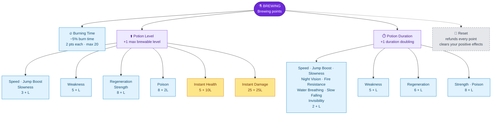

---
{"dg-publish":true,"permalink":"/skills/brewing-skill/","title":"Brewing Skill","tags":["guide","minecraft","leveling","skills","brewing","potions","upgrades"],"dg-note-properties":{"title":"Brewing Skill","tags":["guide","minecraft","leveling","skills","brewing","potions","upgrades"],"aliases":["Brewing"]}}
---

# Brewing Skill

**Menu icon:** Potion · **XP curve:** 100, +10 per level

## Earning XP

- **Normal brewing:** each finished brew gives **20 XP**, shared evenly by all players within **5 blocks** of the stand.
- **Custom brewing:** each finished custom brew gives the brewer **20 XP**. See [[Custom Potion Brewing\|Custom Potion Brewing]].

## Upgrade Tree

`L` = how many times you've already bought that upgrade.

### Burning Time

| Upgrade | Icon | Effect | Cost | Max |
|---|---|---|---|---|
| Burning Time | Flint and steel | −5% burn duration per level (you start at **200%**) | 2 | 20 |

10 upgrades = normal burn time. 20 upgrades = you barely burn at all.

### Potion Level ("Can brew potions of level X")

Each upgrade raises the **highest level** of that potion you can **brew and use** by 1. With 0 upgrades your limit is level II; each upgrade adds one more (III, IV, …).

| Potion | Menu icon | Cost of next upgrade |
|---|---|---|
| Speed | Sugar | 3 + L |
| Jump Boost | Rabbit's foot | 3 + L |
| Slowness | Iron block | 3 + L |
| Weakness | Wooden sword | 5 + L |
| Instant Health | Glistering melon | 5 + 10 × L |
| Regeneration | Ghast tear | 8 + L |
| Strength | Blaze powder | 8 + L |
| Poison | Spider eye | 8 + 2 × L |
| Instant Damage | Iron sword | 25 + 25 × L |

### Potion Duration ("Can double the time")

Each upgrade lets you **double** that potion's duration once more (by brewing with redstone) and still use it.

| Potion | Menu icon | Cost of next upgrade |
|---|---|---|
| Speed | Sugar cane | 2 + L |
| Jump Boost | Rabbit hide | 2 + L |
| Slowness | Iron ingot | 2 + L |
| Night Vision | Golden carrot | 2 + L |
| Fire Resistance | Magma cream | 2 + L |
| Water Breathing | Pufferfish | 2 + L |
| Slow Falling | Phantom membrane | 2 + L |
| Invisibility | Glass | 2 + L |
| Weakness | Copper sword | 5 + L |
| Regeneration | Dried ghast | 6 + L |
| Strength | Blaze rod | 8 + L |
| Poison | Fermented spider eye | 8 + L |

> [!IMPORTANT]
> Your upgrades also limit **using** potions. A custom potion above your own level or duration can't be drunk or thrown (`Potion to high level cant drink`). Thrown ones come back to you. A strong potion handed to a low-level friend won't work for them!

## Reset

The iron door resets all Brewing upgrades, refunds all points, and **removes your active positive effects** (Speed, Strength, Regeneration, Fire Resistance, Night Vision, Invisibility, Water Breathing, Jump Boost, Slow Falling).

---
Related: [[Upgrade Trees\|Upgrade Trees]] · [[Custom Potion Brewing\|Custom Potion Brewing]] · [[Skills/Defense Skill\|Defense Skill]] · [[Skills and Skill Points\|Skills and Skill Points]]
