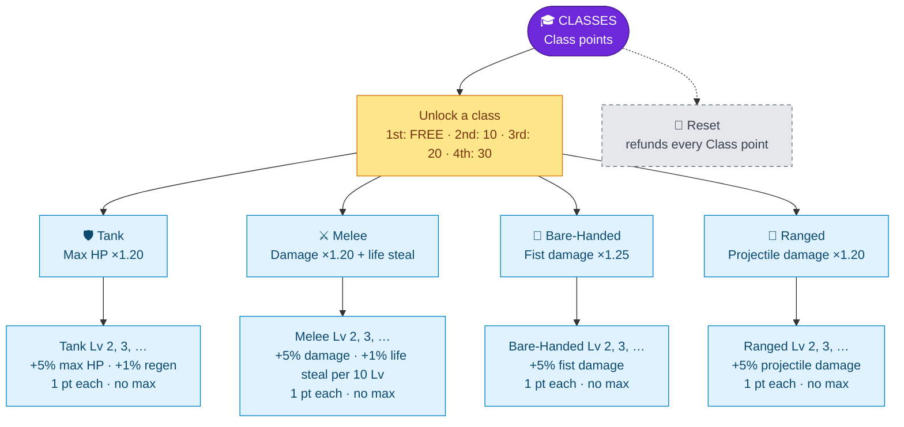

---
{"dg-publish":true,"permalink":"/skills/classes/","title":"Classes","tags":["guide","minecraft","leveling","skills","classes","upgrades"],"dg-note-properties":{"title":"Classes","tags":["guide","minecraft","leveling","skills","classes","upgrades"],"aliases":["Classes Skill","Class System"]}}
---

# Classes

**Menu icon:** Player head · **Points:** Class points

Classes are the "meta" skill. You don't earn Class XP directly. **Every level you gain in any other skill gives 1 Class XP**, and each Class level needs 10 XP, so **10 skill levels = 1 Class point**.

> [!TIP] Your first class is free
> The first class costs **0 points**, so you can unlock it the moment you join, before you've earned anything.

## Upgrade Tree

## The four classes

| Class | Icon | Effect | Scaling |
|---|---|---|---|
| **Tank** | Iron chestplate | Multiplies your **max health**; boosts food & potion regeneration | Health × (1.15 + 0.05 × level). Regen × (1 + 0.01 × level) |
| **Melee** | Iron sword | Multiplies your **attack damage**; **life steal** on every melee hit | Damage × (1.15 + 0.05 × level). Life steal: 1% of damage dealt, +1% per 10 class levels |
| **Bare-Handed** | Oak fence | Multiplies **damage with an empty hand** | Fist damage × (1.20 + 0.05 × level) |
| **Ranged** | Bow | Multiplies **arrow/projectile damage** | Projectile damage × (1.15 + 0.05 × level). Ender pearls and fireworks excluded |

Examples at class level 10: Tank ×1.65 HP · Melee ×1.65 damage · Bare-Handed ×1.70 fist damage · Ranged ×1.65 arrow damage.

> [!TIP] Combos
> Bare-Handed stacks with *Bare-Handed Damage* from the [[Skills/Combat Skill\|Combat Skill]]: the flat bonus is added first, then the class multiplies it. Ranged works the same way with *Bow Damage*.

## Reset & losing Class levels

- The iron door refunds all Class points and removes all classes.
- Losing Combat levels in PvP also costs Class XP. If your Class points go negative, you have to remove class upgrades before you can move again. Removing an unlocked class refunds its unlock cost. See [[PvP and Death Penalty\|PvP and Death Penalty]].

---
Related: [[Upgrade Trees\|Upgrade Trees]] · [[Skills and Skill Points\|Skills and Skill Points]] · [[Skills/Combat Skill\|Combat Skill]] · [[Skills/Defense Skill\|Defense Skill]]
