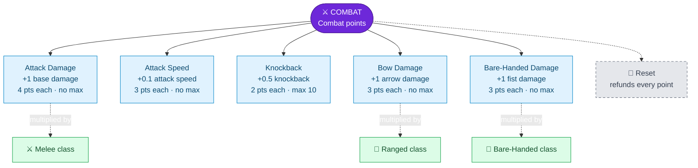

---
{"dg-publish":true,"permalink":"/skills/combat-skill/","title":"Combat Skill","tags":["guide","minecraft","leveling","skills","combat","pvp","upgrades"],"dg-note-properties":{"title":"Combat Skill","tags":["guide","minecraft","leveling","skills","combat","pvp","upgrades"],"aliases":["Combat"]}}
---

# Combat Skill

**Menu icon:** Iron sword · **XP curve:** 100, +25 per level (the steepest skill)

Your Combat level is shown **under your name tag** for everyone to see.

## Earning XP

- **Hostile monster kill:** 5 XP (zombies, skeletons, creepers, spiders, endermen, …; slimes, ghasts and phantoms don't count).
  - Your first kill starts a **10-minute window**. Kills 1–60 give 5 XP, kills 61–1,000 give 1 XP, after that nothing until the window ends.
- **Player kill:** big rewards, but you can also lose XP. See [[PvP and Death Penalty\|PvP and Death Penalty]].

## Upgrade Tree

## Upgrades

| Upgrade | Icon | Effect per upgrade | Cost | Max |
|---|---|---|---|---|
| Attack Damage | Diamond sword | +1 base attack damage (start: 1) | 4 | none |
| Attack Speed | Golden sword | +0.1 attack speed (start: 3.1) | 3 | none |
| Knockback | Stick | +0.5 attack knockback | 2 | 10 |
| Bow Damage | Bow | +1 damage on every arrow you shoot | 3 | none |
| Bare-Handed Damage | Oak fence | +1 damage when your main hand is empty | 3 | none |

> [!TIP]
> Attack Damage boosts every melee weapon *and* your fist. Bow and Bare-Handed Damage get multiplied by the matching [[Skills/Classes\|Classes]].

## Reset

The iron door sets attack damage back to 1, attack speed to 3.1, knockback to 0 and refunds all points.

If you lost Combat levels and your points are negative, `/menu` opens **"Remove Combat Upgrades"** instead. See [[PvP and Death Penalty\|PvP and Death Penalty]].

---
Related: [[Upgrade Trees\|Upgrade Trees]] · [[Skills/Classes\|Classes]] · [[PvP and Death Penalty\|PvP and Death Penalty]] · [[Skills and Skill Points\|Skills and Skill Points]]
