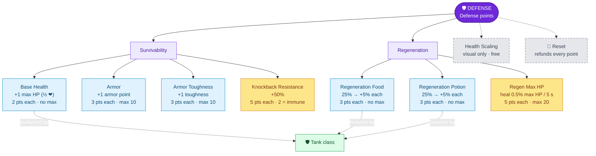

---
{"dg-publish":true,"permalink":"/skills/defense-skill/","title":"Defense Skill","tags":["guide","minecraft","leveling","skills","defense","upgrades"],"dg-note-properties":{"title":"Defense Skill","tags":["guide","minecraft","leveling","skills","defense","upgrades"],"aliases":["Defense"]}}
---

# Defense Skill

**Menu icon:** Shield · **XP curve:** 100, +10 per level

## Earning XP

You get **1 XP for every half-heart you heal** (rounded): eating, natural regeneration, Regeneration potions, beacons, golden apples, totems, instant health.

> [!TIP]
> Natural regeneration heals in tiny steps that often round to 0 XP. Big heals (potions, golden apples) level Defense much faster.

## Upgrade Tree

## Upgrades

| Upgrade | Icon | Effect per upgrade | Cost | Max |
|---|---|---|---|---|
| Base Health | Apple | +1 max HP (half a heart). Start: 10 HP | 2 | none |
| Armor | Iron chestplate | +1 armor point (works even without armor) | 3 | 10 |
| Armor Toughness | Netherite chestplate | +1 armor toughness | 3 | 10 |
| Knockback Resistance | Stick | +50% knockback resistance | 5 | 2 upgrades = full immunity |
| Regeneration Food | Cooked beef | Food-based healing: starts at 25%, +5% per upgrade | 3 | none (normal speed at 15) |
| Regeneration Potion | Potion | Regeneration-effect healing: starts at 25%, +5% per upgrade | 3 | none |
| Regen Max HP | Golden chestplate | Heals **0.5% of your max HP every 5 seconds** per upgrade | 5 | 20 (= 10% per 5 s) |
| Health Scaling | Lime glazed terracotta | **Visual only.** Left-click +20, right-click −20; lowest setting = off | free | n/a |

> [!TIP]
> The **Tank** class multiplies your max health and boosts both regeneration upgrades. See [[Skills/Classes\|Classes]].
> Regeneration above level VI gets a small extra boost, so very strong potions still pay off. See [[Custom Potion Brewing\|Custom Potion Brewing]].

## Reset

The iron door resets max HP to 10, armor, toughness, knockback resistance and all regeneration upgrades to 0, and refunds all points.

---
Related: [[Upgrade Trees\|Upgrade Trees]] · [[Skills/Classes\|Classes]] · [[Starting Stats\|Starting Stats]] · [[Skills and Skill Points\|Skills and Skill Points]]
