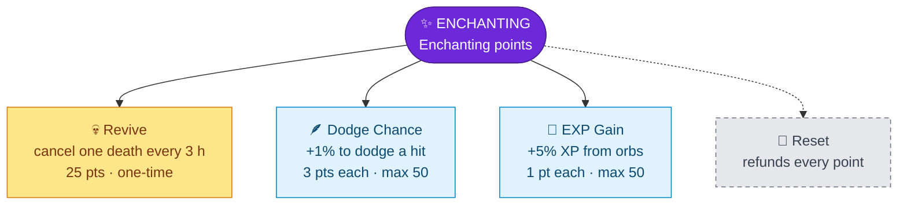

---
{"dg-publish":true,"permalink":"/skills/enchanting-skill/","title":"Enchanting Skill","tags":["guide","minecraft","leveling","skills","enchanting","upgrades"],"dg-note-properties":{"title":"Enchanting Skill","tags":["guide","minecraft","leveling","skills","enchanting","upgrades"],"aliases":["Enchanting","Revive","Dodge"]}}
---

# Enchanting Skill

**Menu icon:** Enchanting table · **XP curve:** 100, +10 per level

## Earning XP

Enchant an item at an **enchanting table**. You get Enchanting XP equal to the **level requirement** of the enchantment you chose. A level-30 enchant gives 30 XP.

## Upgrade Tree

## Upgrades

| Upgrade | Icon | Effect | Cost | Max |
|---|---|---|---|---|
| Revive | Totem of Undying | **Cheat death:** once every 3 hours a death is cancelled and you stay alive | 25 | one-time |
| Dodge Chance | Feather | ~1% chance per level to **completely dodge** a hit from a mob, player or projectile | 3 | 50 (≈50%) |
| EXP Gain | Bottle o' Enchanting | +5% normal XP from orbs per level | 1 | 50 (= ×3.5) |

> [!NOTE]
> Dodge only works against attacks from mobs, players and projectiles. It doesn't help against fall damage, fire, lava or drowning.

## Reset

The iron door removes Revive, Dodge Chance and EXP Gain and refunds all points.

---
Related: [[Upgrade Trees\|Upgrade Trees]] · [[PvP and Death Penalty\|PvP and Death Penalty]] · [[Skills and Skill Points\|Skills and Skill Points]]
