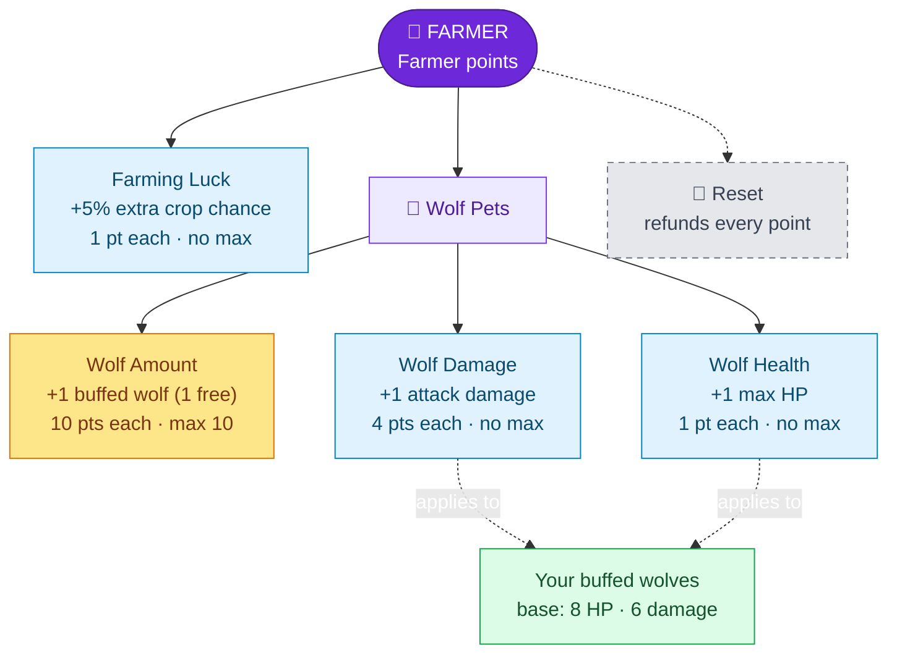

---
{"dg-publish":true,"permalink":"/skills/farming-skill/","title":"Farming Skill","tags":["guide","minecraft","leveling","skills","farming","pets","upgrades"],"dg-note-properties":{"title":"Farming Skill","tags":["guide","minecraft","leveling","skills","farming","pets","upgrades"],"aliases":["Farmer","Farming","Wolf Pets"]}}
---

# Farming Skill

**Menu icon:** Diamond hoe ("Farmer") · **XP curve:** 100, +10 per level

## Earning XP

Harvest **fully grown** crops: **1 XP each**.

| Crop | Gives XP |
|---|---|
| Wheat | ✅ |
| Carrots | ✅ |
| Potatoes | ✅ |
| Beetroot, melons, pumpkins, sugar cane, nether wart, … | ❌ |

## Upgrade Tree

## Upgrades

| Upgrade | Icon | Effect | Cost | Max |
|---|---|---|---|---|
| Farming Luck | Golden hoe | Extra crop drops (+5% per level, +1 guaranteed per 20 levels, like Mining Luck) | 1 | none |
| Wolf Amount | Lead | +1 wolf that can receive your buffs | 10 | 10 |
| Wolf Damage | Copper sword | +1 attack damage for your buffed wolves | 4 | none |
| Wolf Health | Copper chestplate | +1 max HP for your buffed wolves | 1 | none |

## Buffed wolf pets (step by step)

1. Tame a wolf as usual.
2. **Right-click your own wolf** to make it a buffed pet.
3. A buffed wolf gets **8 + Wolf Health** max HP and **6 + Wolf Damage** attack damage.
4. You can buff **1 wolf for free**, plus 1 per *Wolf Amount* level (up to 11).
5. At your limit you'll see `To meany Pets ;)`.
6. After buying more Wolf Health or Damage, right-click your wolves again to apply the new values.
7. When a buffed wolf dies, its slot frees up for a new one.

> [!TIP]
> Buffed wolves start at 8 HP (4 hearts). Put a few points into *Wolf Health* before you buff a wolf you care about.

## Reset

The iron door resets Farming Luck and all wolf upgrades and refunds all points.

---
Related: [[Upgrade Trees\|Upgrade Trees]] · [[Skills/Mining Skill\|Mining Skill]] · [[Skills and Skill Points\|Skills and Skill Points]]
