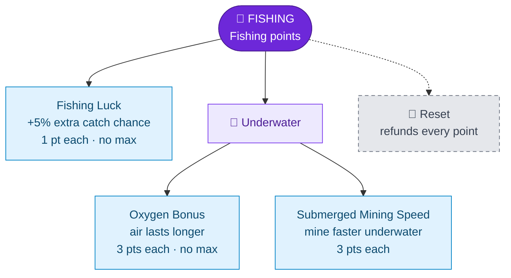

---
{"dg-publish":true,"permalink":"/skills/fishing-skill/","title":"Fishing Skill","tags":["guide","minecraft","leveling","skills","fishing","upgrades"],"dg-note-properties":{"title":"Fishing Skill","tags":["guide","minecraft","leveling","skills","fishing","upgrades"],"aliases":["Fishing"]}}
---

# Fishing Skill

**Menu icon:** Fishing rod · **XP curve:** 100, +10 per level

## Earning XP

| Catch | XP |
|---|---|
| Cod | 4 |
| Salmon | 6 |
| Pufferfish | 8 |
| Tropical fish | 10 |
| Junk (lily pad, bowl, leather, leather boots, rotten flesh, stick, string, bone, ink sac, tripwire hook) | 10 |
| Fishing rod | 16 |
| Name tag, nautilus shell, saddle | 20 |
| Bow, enchanted book | 24 |

## Upgrade Tree

## Upgrades

| Upgrade | Icon | Effect | Cost | Max |
|---|---|---|---|---|
| Fishing Luck | Rabbit's foot | Extra copies of your catch (+5% per level, +1 guaranteed per 20 levels) | 1 | none |
| Oxygen Bonus | Glass bottle | +1 oxygen bonus: you run out of air more slowly | 3 | none |
| Submerged Mining Speed | Diamond pickaxe | Faster mining underwater (you start at half speed) | 3 | none |

> [!NOTE]
> Fishing Luck copies treasure too, but extra enchanted books and bows come **without** enchantments. Name tags, saddles and nautilus shells are copied normally.

## Reset

The iron door resets all Fishing upgrades and refunds all points.

---
Related: [[Upgrade Trees\|Upgrade Trees]] · [[Skills/Mining Skill\|Mining Skill]] · [[Skills and Skill Points\|Skills and Skill Points]]
