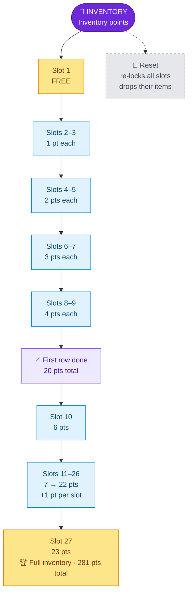

---
{"dg-publish":true,"permalink":"/skills/inventory-skill/","title":"Inventory Skill","tags":["guide","minecraft","leveling","skills","inventory","upgrades"],"dg-note-properties":{"title":"Inventory Skill","tags":["guide","minecraft","leveling","skills","inventory","upgrades"],"aliases":["Inventory","Slot Unlocks"]}}
---

# Inventory Skill

**Menu icon:** Chest · **XP curve:** 100, +10 per level

At the start only your **hotbar** works. The other 27 slots hold red **"Slot Locked"** barriers. You can't move them, they don't drop when you die, and they come back when you respawn.

## Earning XP

| Action | XP | Limit |
|---|---|---|
| Craft (each craft; a shift-click counts once) | 15 | 20 per 20 minutes |
| Pick up an item (each pickup, any stack size) | 5 | 64 per 20 minutes |

## Upgrade Tree

Click the **barrier** icon to unlock **one slot** at a time. Slots open from the bottom-right of your inventory upward. The tooltip shows your progress (`x/27`) and the next price.

| Unlock # | Cost | | Unlock # | Cost |
|---|---|---|---|---|
| 1 | **0 (free)** | | 10 | 6 |
| 2–3 | 1 each | | 11 | 7 |
| 4–5 | 2 each | | 12 | 8 |
| 6–7 | 3 each | | … | +1 each |
| 8–9 | 4 each | | 27 | 23 |

## Reset

Resetting locks all 27 slots again and **drops everything in them on the ground**. Put your items in a chest first.

---
Related: [[Upgrade Trees\|Upgrade Trees]] · [[Beginner Guide\|Beginner Guide]] · [[Starting Stats\|Starting Stats]] · [[Skills and Skill Points\|Skills and Skill Points]]
