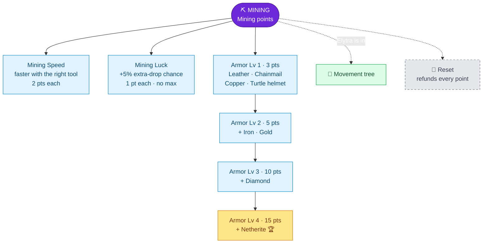

---
{"dg-publish":true,"permalink":"/skills/mining-skill/","title":"Mining Skill","tags":["guide","minecraft","leveling","skills","mining","armor","upgrades"],"dg-note-properties":{"title":"Mining Skill","tags":["guide","minecraft","leveling","skills","mining","armor","upgrades"],"aliases":["Mining","Armor Tiers"]}}
---

# Mining Skill

**Menu icon:** Iron pickaxe · **XP curve:** 100, +10 per level

## Earning XP

Mine ores **without Silk Touch**:

| Ore (incl. deepslate) | XP | | Ore | XP |
|---|---|---|---|---|
| Copper | 1 | | Redstone | 6 |
| Coal | 2 | | Lapis | 6 |
| Iron | 4 | | Diamond | 15 |
| Gold | 4 | | Emerald | **50** |
| Nether gold | 1 | | Nether quartz | 1 |

Ancient Debris gives no XP and no luck bonus.

## Upgrade Tree

## Upgrades

| Upgrade | Icon | Effect | Cost | Max |
|---|---|---|---|---|
| Mining Speed | Golden pickaxe | Mine faster with the correct tool | 2 | none |
| Mining Luck | Rabbit's foot | Chance for **extra ore drops** | 1 | none |
| Armor Level | Netherite chestplate | Unlocks the next **armor tier** | 3 / 5 / 10 / 15 | 4 |

### Mining Luck scaling

Each level adds **+5% chance** of 1 extra drop. Every **20 levels** turns into one *guaranteed* extra drop, and the chance starts over:

| Luck level | Extra drops per ore |
|---|---|
| 10 | 50% chance of +1 |
| 20 | +1 guaranteed |
| 30 | +1 guaranteed, 50% chance of +2 |
| 40 | +2 guaranteed |

The extra drop is the ore's normal item (raw iron, diamond, coal, …).

### Armor tiers

> [!IMPORTANT]
> **You can't wear any armor at Armor Level 0.** Anything you equip goes back into your inventory (or drops if it's full).

| Armor Level | Cost | You can wear |
|---|---|---|
| 1 | 3 | Leather, Chainmail, Copper, Turtle helmet |
| 2 | 5 | + Iron, Gold |
| 3 | 10 | + Diamond |
| 4 | 15 | + Netherite |

Full Netherite costs **33 points** in total. The **Elytra** is unlocked in the [[Skills/Movement Skill\|Movement Skill]].

## Reset

The iron door removes Mining Speed, Mining Luck and all armor tiers, and refunds all points.

---
Related: [[Upgrade Trees\|Upgrade Trees]] · [[Skills/Movement Skill\|Movement Skill]] · [[Skills/Defense Skill\|Defense Skill]] · [[Skills and Skill Points\|Skills and Skill Points]]
