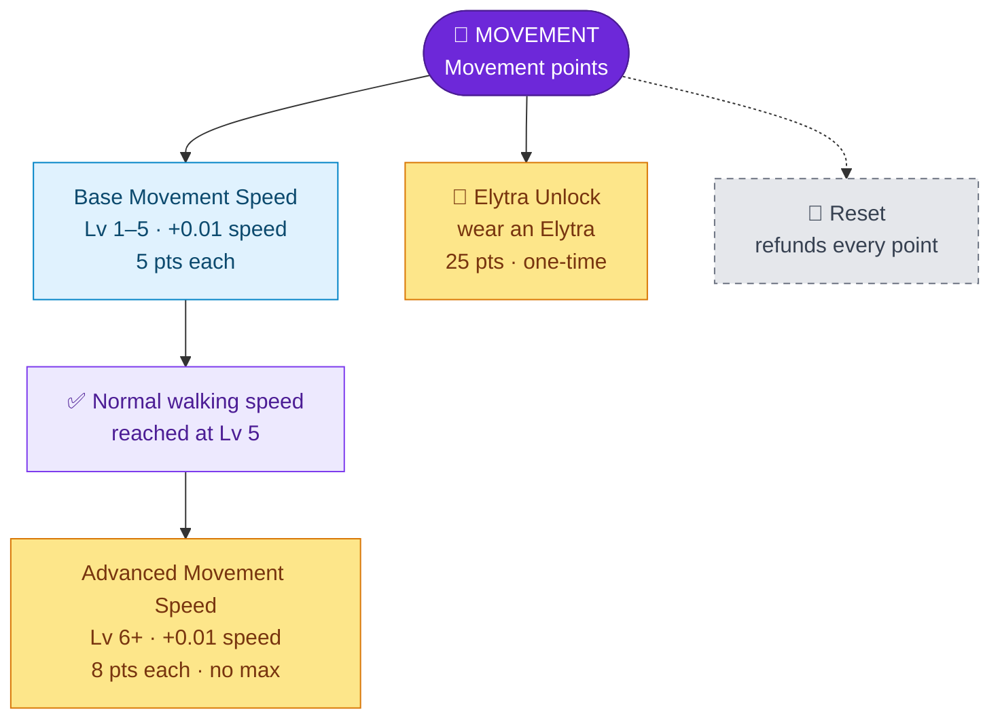

---
{"dg-publish":true,"permalink":"/skills/movement-skill/","title":"Movement Skill","tags":["guide","minecraft","leveling","skills","movement","upgrades"],"dg-note-properties":{"title":"Movement Skill","tags":["guide","minecraft","leveling","skills","movement","upgrades"],"aliases":["Movement","Elytra Unlock"]}}
---

# Movement Skill

**Menu icon:** Leather boots · **XP curve:** 500, +20 per level (the slowest skill to level)

## Earning XP

Every 5 seconds the game counts how far you **walked and sprinted**. Swimming, flying, riding and gliding don't count.

- At starting speed you get about **1 XP per 2 blocks**.
- XP is scaled to your speed, so faster players need to travel a bit further for the same XP.
- Up to 10 XP per 5 seconds counts in full. Anything above that counts only 1/10.

## Upgrade Tree

## Upgrades

| Upgrade | Icon | Effect | Cost | Max |
|---|---|---|---|---|
| Base Movement Speed | Golden boots | +0.01 walking speed (start 0.05, normal 0.10) | **5** for the first 5, then **8** each | none |
| Elytra Unlock | Elytra | Lets you equip an Elytra | 25 | one-time |

- 5 speed upgrades (25 points) bring you back to **normal speed**.
- Every upgrade after that makes you **faster than normal**.
- Without the Elytra Unlock, an Elytra in your chest slot goes straight back into your inventory.

## Reset

The iron door sets your speed back to 0.05, re-locks the Elytra and refunds all points.

---
Related: [[Upgrade Trees\|Upgrade Trees]] · [[Skills/Mining Skill\|Mining Skill]] · [[Starting Stats\|Starting Stats]] · [[Skills and Skill Points\|Skills and Skill Points]]
