---
{"dg-publish":true,"permalink":"/upgrade-trees/","title":"Upgrade Trees","tags":["guide","minecraft","leveling","upgrades","skills"],"dg-note-properties":{"title":"Upgrade Trees","tags":["guide","minecraft","leveling","upgrades","skills"],"aliases":["Skill Trees","All Upgrades"]}}
---

# Upgrade Trees

Every skill tree on one page. Each tree is pulled live from its skill note, so it's always up to date.

**How to read the trees**

| Box | Meaning |
|---|---|
| 🟣 Purple (rounded) | The skill and its point type |
| 🔵 Blue | A normal upgrade you can buy repeatedly or step by step |
| 🟡 Gold | A big milestone or one-time unlock |
| 🟢 Green (dotted arrow) | Another skill or class that boosts this upgrade |
| ⚪ Grey (dashed) | Reset or a free visual option |
| Solid arrow → | Buy the first one to reach the next |

## Overview

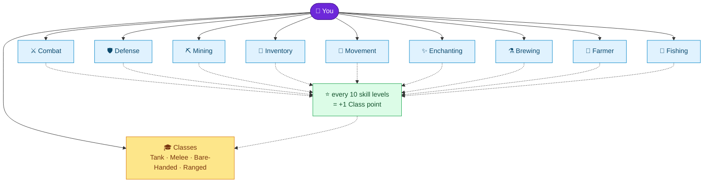

## 🎓 Classes

<a class="markdown-embed-link" href="/skills/classes/#upgrade-tree" aria-label="Open link"><svg xmlns="http://www.w3.org/2000/svg" width="24" height="24" viewBox="0 0 24 24" fill="none" stroke="currentColor" stroke-width="2" stroke-linecap="round" stroke-linejoin="round" class="svg-icon lucide-link"><path d="M10 13a5 5 0 0 0 7.54.54l3-3a5 5 0 0 0-7.07-7.07l-1.72 1.71"></path><path d="M14 11a5 5 0 0 0-7.54-.54l-3 3a5 5 0 0 0 7.07 7.07l1.71-1.71"></path></svg></a>

## Upgrade Tree

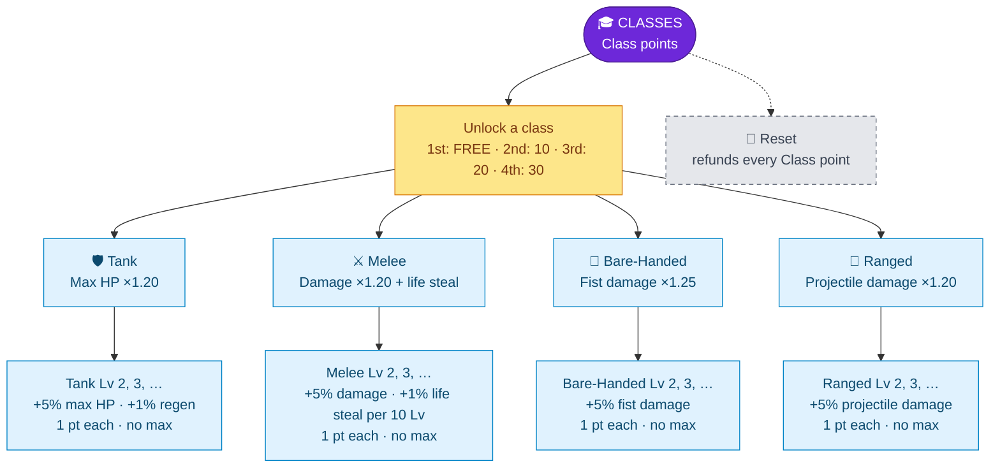

## ⚔️ Combat

<a class="markdown-embed-link" href="/skills/combat-skill/#upgrade-tree" aria-label="Open link"><svg xmlns="http://www.w3.org/2000/svg" width="24" height="24" viewBox="0 0 24 24" fill="none" stroke="currentColor" stroke-width="2" stroke-linecap="round" stroke-linejoin="round" class="svg-icon lucide-link"><path d="M10 13a5 5 0 0 0 7.54.54l3-3a5 5 0 0 0-7.07-7.07l-1.72 1.71"></path><path d="M14 11a5 5 0 0 0-7.54-.54l-3 3a5 5 0 0 0 7.07 7.07l1.71-1.71"></path></svg></a>

## Upgrade Tree

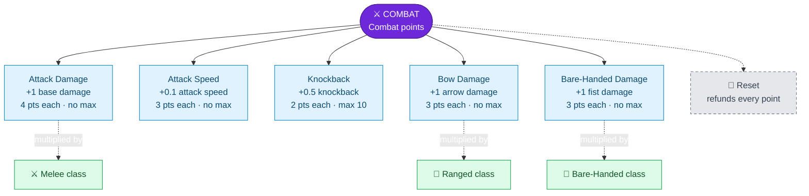

## 🛡️ Defense

<a class="markdown-embed-link" href="/skills/defense-skill/#upgrade-tree" aria-label="Open link"><svg xmlns="http://www.w3.org/2000/svg" width="24" height="24" viewBox="0 0 24 24" fill="none" stroke="currentColor" stroke-width="2" stroke-linecap="round" stroke-linejoin="round" class="svg-icon lucide-link"><path d="M10 13a5 5 0 0 0 7.54.54l3-3a5 5 0 0 0-7.07-7.07l-1.72 1.71"></path><path d="M14 11a5 5 0 0 0-7.54-.54l-3 3a5 5 0 0 0 7.07 7.07l1.71-1.71"></path></svg></a>

## Upgrade Tree

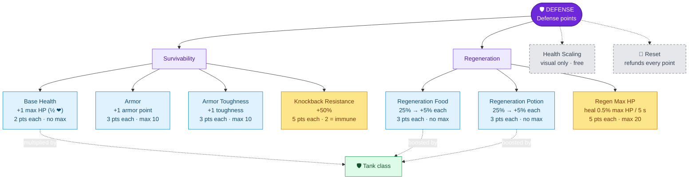

## ⛏️ Mining

<a class="markdown-embed-link" href="/skills/mining-skill/#upgrade-tree" aria-label="Open link"><svg xmlns="http://www.w3.org/2000/svg" width="24" height="24" viewBox="0 0 24 24" fill="none" stroke="currentColor" stroke-width="2" stroke-linecap="round" stroke-linejoin="round" class="svg-icon lucide-link"><path d="M10 13a5 5 0 0 0 7.54.54l3-3a5 5 0 0 0-7.07-7.07l-1.72 1.71"></path><path d="M14 11a5 5 0 0 0-7.54-.54l-3 3a5 5 0 0 0 7.07 7.07l1.71-1.71"></path></svg></a>

## Upgrade Tree

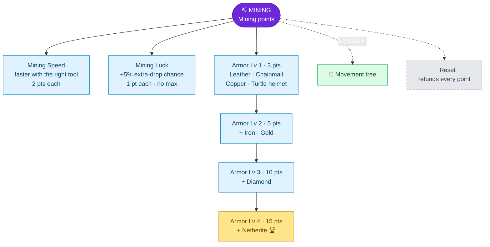

## 🎒 Inventory

<a class="markdown-embed-link" href="/skills/inventory-skill/#upgrade-tree" aria-label="Open link"><svg xmlns="http://www.w3.org/2000/svg" width="24" height="24" viewBox="0 0 24 24" fill="none" stroke="currentColor" stroke-width="2" stroke-linecap="round" stroke-linejoin="round" class="svg-icon lucide-link"><path d="M10 13a5 5 0 0 0 7.54.54l3-3a5 5 0 0 0-7.07-7.07l-1.72 1.71"></path><path d="M14 11a5 5 0 0 0-7.54-.54l-3 3a5 5 0 0 0 7.07 7.07l1.71-1.71"></path></svg></a>

## Upgrade Tree

Click the **barrier** icon to unlock **one slot** at a time. Slots open from the bottom-right of your inventory upward. The tooltip shows your progress (`x/27`) and the next price.

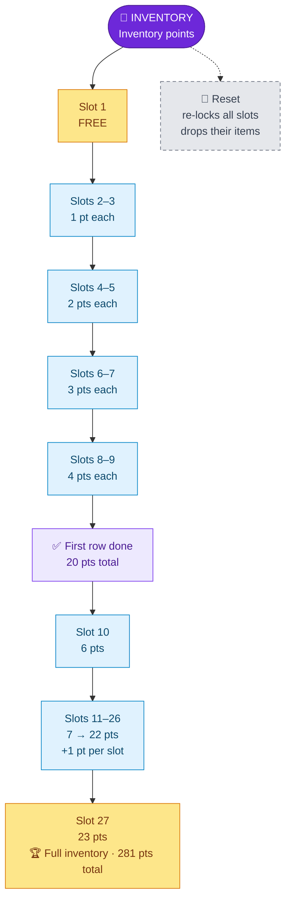

| Unlock # | Cost | | Unlock # | Cost |
|---|---|---|---|---|
| 1 | **0 (free)** | | 10 | 6 |
| 2–3 | 1 each | | 11 | 7 |
| 4–5 | 2 each | | 12 | 8 |
| 6–7 | 3 each | | … | +1 each |
| 8–9 | 4 each | | 27 | 23 |

## 👢 Movement

<a class="markdown-embed-link" href="/skills/movement-skill/#upgrade-tree" aria-label="Open link"><svg xmlns="http://www.w3.org/2000/svg" width="24" height="24" viewBox="0 0 24 24" fill="none" stroke="currentColor" stroke-width="2" stroke-linecap="round" stroke-linejoin="round" class="svg-icon lucide-link"><path d="M10 13a5 5 0 0 0 7.54.54l3-3a5 5 0 0 0-7.07-7.07l-1.72 1.71"></path><path d="M14 11a5 5 0 0 0-7.54-.54l-3 3a5 5 0 0 0 7.07 7.07l1.71-1.71"></path></svg></a>

## Upgrade Tree

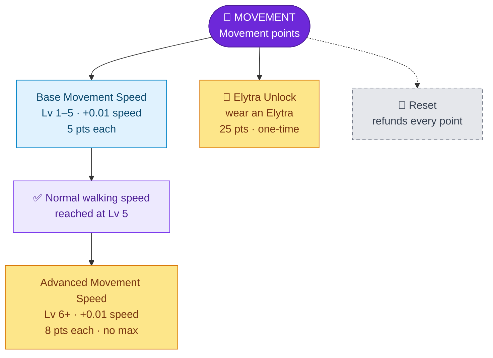

## ✨ Enchanting

<a class="markdown-embed-link" href="/skills/enchanting-skill/#upgrade-tree" aria-label="Open link"><svg xmlns="http://www.w3.org/2000/svg" width="24" height="24" viewBox="0 0 24 24" fill="none" stroke="currentColor" stroke-width="2" stroke-linecap="round" stroke-linejoin="round" class="svg-icon lucide-link"><path d="M10 13a5 5 0 0 0 7.54.54l3-3a5 5 0 0 0-7.07-7.07l-1.72 1.71"></path><path d="M14 11a5 5 0 0 0-7.54-.54l-3 3a5 5 0 0 0 7.07 7.07l1.71-1.71"></path></svg></a>

## Upgrade Tree

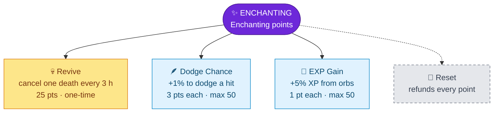

## ⚗️ Brewing

<a class="markdown-embed-link" href="/skills/brewing-skill/#upgrade-tree" aria-label="Open link"><svg xmlns="http://www.w3.org/2000/svg" width="24" height="24" viewBox="0 0 24 24" fill="none" stroke="currentColor" stroke-width="2" stroke-linecap="round" stroke-linejoin="round" class="svg-icon lucide-link"><path d="M10 13a5 5 0 0 0 7.54.54l3-3a5 5 0 0 0-7.07-7.07l-1.72 1.71"></path><path d="M14 11a5 5 0 0 0-7.54-.54l-3 3a5 5 0 0 0 7.07 7.07l1.71-1.71"></path></svg></a>

## Upgrade Tree

`L` = how many times you've already bought that upgrade.

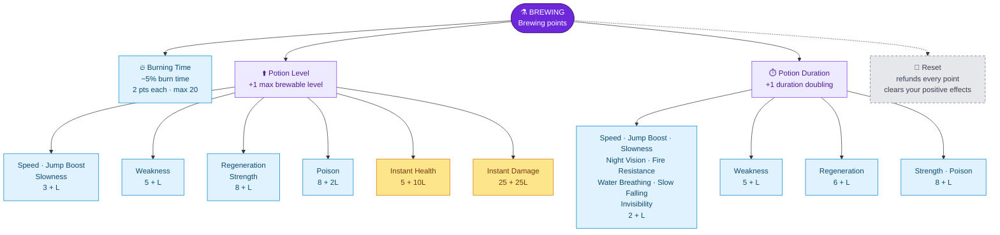

### Burning Time

| Upgrade | Icon | Effect | Cost | Max |
|---|---|---|---|---|
| Burning Time | Flint and steel | −5% burn duration per level (you start at **200%**) | 2 | 20 |

10 upgrades = normal burn time. 20 upgrades = you barely burn at all.

### Potion Level ("Can brew potions of level X")

Each upgrade raises the **highest level** of that potion you can **brew and use** by 1. With 0 upgrades your limit is level II; each upgrade adds one more (III, IV, …).

| Potion | Menu icon | Cost of next upgrade |
|---|---|---|
| Speed | Sugar | 3 + L |
| Jump Boost | Rabbit's foot | 3 + L |
| Slowness | Iron block | 3 + L |
| Weakness | Wooden sword | 5 + L |
| Instant Health | Glistering melon | 5 + 10 × L |
| Regeneration | Ghast tear | 8 + L |
| Strength | Blaze powder | 8 + L |
| Poison | Spider eye | 8 + 2 × L |
| Instant Damage | Iron sword | 25 + 25 × L |

### Potion Duration ("Can double the time")

Each upgrade lets you **double** that potion's duration once more (by brewing with redstone) and still use it.

| Potion | Menu icon | Cost of next upgrade |
|---|---|---|
| Speed | Sugar cane | 2 + L |
| Jump Boost | Rabbit hide | 2 + L |
| Slowness | Iron ingot | 2 + L |
| Night Vision | Golden carrot | 2 + L |
| Fire Resistance | Magma cream | 2 + L |
| Water Breathing | Pufferfish | 2 + L |
| Slow Falling | Phantom membrane | 2 + L |
| Invisibility | Glass | 2 + L |
| Weakness | Copper sword | 5 + L |
| Regeneration | Dried ghast | 6 + L |
| Strength | Blaze rod | 8 + L |
| Poison | Fermented spider eye | 8 + L |

> [!IMPORTANT]
> Your upgrades also limit **using** potions. A custom potion above your own level or duration can't be drunk or thrown (`Potion to high level cant drink`). Thrown ones come back to you. A strong potion handed to a low-level friend won't work for them!

## 🌾 Farmer

<a class="markdown-embed-link" href="/skills/farming-skill/#upgrade-tree" aria-label="Open link"><svg xmlns="http://www.w3.org/2000/svg" width="24" height="24" viewBox="0 0 24 24" fill="none" stroke="currentColor" stroke-width="2" stroke-linecap="round" stroke-linejoin="round" class="svg-icon lucide-link"><path d="M10 13a5 5 0 0 0 7.54.54l3-3a5 5 0 0 0-7.07-7.07l-1.72 1.71"></path><path d="M14 11a5 5 0 0 0-7.54-.54l-3 3a5 5 0 0 0 7.07 7.07l1.71-1.71"></path></svg></a>

## Upgrade Tree

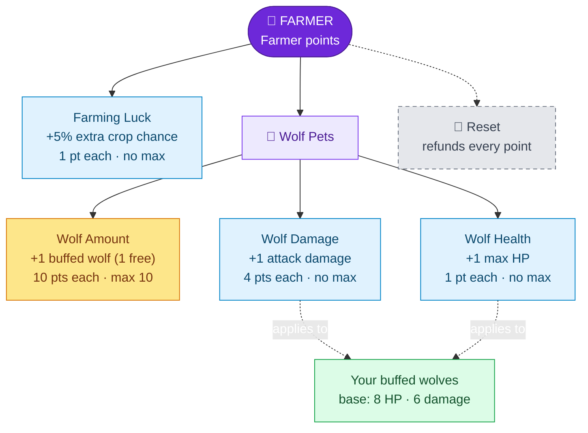

## 🎣 Fishing

<a class="markdown-embed-link" href="/skills/fishing-skill/#upgrade-tree" aria-label="Open link"><svg xmlns="http://www.w3.org/2000/svg" width="24" height="24" viewBox="0 0 24 24" fill="none" stroke="currentColor" stroke-width="2" stroke-linecap="round" stroke-linejoin="round" class="svg-icon lucide-link"><path d="M10 13a5 5 0 0 0 7.54.54l3-3a5 5 0 0 0-7.07-7.07l-1.72 1.71"></path><path d="M14 11a5 5 0 0 0-7.54-.54l-3 3a5 5 0 0 0 7.07 7.07l1.71-1.71"></path></svg></a>

## Upgrade Tree

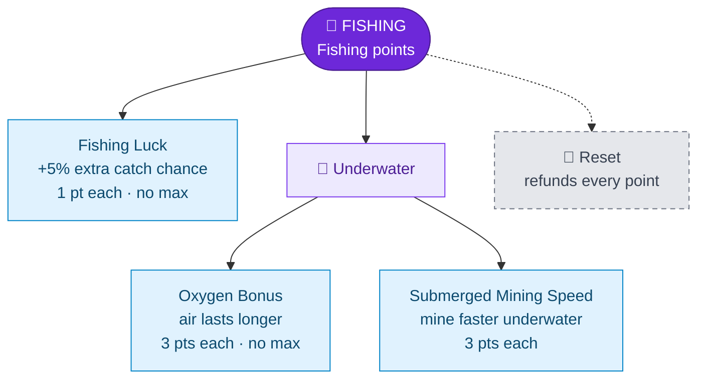

---
Related: [[Leveling Plugin\|Leveling Plugin]] · [[Skills and Skill Points\|Skills and Skill Points]] · [[Beginner Guide\|Beginner Guide]]
